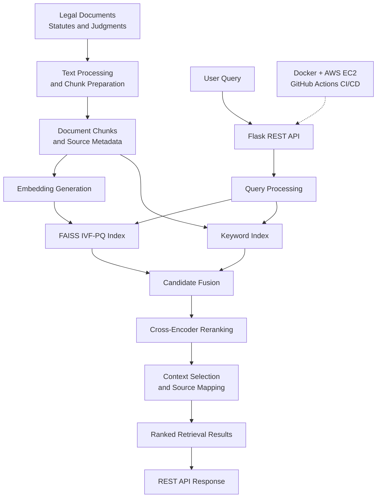

# Nyay Sahayak ⚖️ — Legal AI Retrieval System

**A retrieval-focused legal research backend built with Python, Flask, FAISS, and hybrid search.**

Nyay Sahayak is a legal-document retrieval system designed to retrieve relevant passages from statutory laws and judicial judgments. It combines dense semantic retrieval with keyword-based search, followed by cross-encoder reranking to improve the relevance of the final results.

The system focuses on making legal information easier to discover while preserving source metadata for traceability and citation-oriented retrieval. It is packaged with Docker and deployed on AWS EC2, with GitHub Actions used for CI/CD.

## 🚀 Key Features

- **Hybrid Retrieval:** Combines dense semantic search and keyword retrieval to capture both conceptual relevance and exact legal terminology.
- **FAISS IVF-PQ Indexing:** Uses an approximate nearest-neighbor search architecture with vector compression to support efficient candidate retrieval.
- **Cross-Encoder Reranking:** Re-scores retrieved query–passage pairs to refine the ranking before returning relevant results.
- **Citation-Oriented Retrieval:** Preserves source information through the retrieval pipeline to support traceability to legal provisions and judicial judgments.
- **Context Optimization:** Selects and organizes retrieved passages to prioritize useful evidence while controlling the amount of text carried into downstream processing.
- **Modular REST API:** Exposes retrieval functionality through a Flask backend with separable retrieval components.
- **Performance Optimization:** Incorporates request batching, caching, and I/O optimizations to reduce avoidable processing overhead.
- **Containerized Deployment:** Packages the application using Docker for reproducible deployment.
- **CI/CD:** Uses GitHub Actions to automate configured development and deployment workflows.

## 🏗️ System Architecture

*The diagram presents the intended high-level retrieval architecture. Specific indexing, fusion, and deployment details should match the implementation in the repository.*

## 🧠 How It Works

### 1. Legal Document Processing

The system works with statutory laws and judicial judgments. Documents must be converted into searchable text, organized into passages, and associated with their source information.

Keeping passage text connected to document identifiers and citation metadata is important because a search result should be traceable to its original legal source.

### 2. Dense Semantic Retrieval

Dense retrieval represents document passages and user queries as numerical embeddings. Similarity search then identifies passages whose semantic representations are close to the query representation.

This is useful when the wording of a legal question differs from the language used in a statute or judgment.

**Why it matters:** Semantic retrieval can identify conceptually relevant passages that exact keyword matching may overlook.

### 3. FAISS IVF-PQ Search

FAISS provides the vector-search infrastructure.

The IVF component partitions the vector space into coarse clusters and limits search to selected inverted lists. The Product Quantization (PQ) component compresses vector representations to reduce storage requirements and support approximate distance computation.

This introduces an important trade-off:

- Searching fewer clusters can reduce latency but may miss relevant passages.
- Searching more clusters can improve candidate coverage at additional computational cost.
- Vector compression reduces memory requirements but can introduce approximation error.

The final configuration should balance retrieval quality, search latency, and available resources.

### 4. Keyword Retrieval

Keyword retrieval provides a complementary way to discover passages containing relevant legal terms and identifiers.

Exact terminology, section references, case citations, and distinctive phrases can be especially useful in legal research. Combining lexical and semantic retrieval helps account for queries that require either precise textual matching or broader conceptual matching.

### 5. Candidate Fusion

The dense and keyword retrievers produce candidate lists that are combined before reranking.

A fusion strategy should handle duplicate passages and differences between the ranking scores produced by each retriever.

The goal is to retain relevant candidates from both search methods without sending an unnecessarily large or redundant set to the more computationally expensive ranking stage.

### 6. Cross-Encoder Reranking

Initial retrieval is optimized for efficiently finding candidates. Reranking provides a more detailed relevance assessment.

A cross-encoder evaluates the query and each candidate passage together, producing a relevance score used to reorder the retrieved candidates.

This makes it possible to refine the ranking without evaluating every passage in the full corpus with the cross-encoder.

The trade-off is additional inference cost. Candidate selection and reranking must therefore be balanced against latency requirements.

### 7. Context Selection and Source Traceability

After reranking, relevant passages are selected and organized for the API response or downstream answer-generation component, where applicable.

The retrieval pipeline should preserve source identifiers and citation metadata so results can be traced to their original legal documents.

Context selection also needs to avoid excessive duplication and retain the qualifications or exceptions necessary to interpret a legal passage correctly.

**Important distinction:** Retrieving relevant passages is not the same as establishing that a legal conclusion is correct. Source verification, jurisdiction, effective dates, and the context of a judgment remain important.

## ⚙️ Design Decisions and Trade-offs

| Component | Design rationale | Main trade-off |
|---|---|---|
| Dense retrieval | Captures semantic similarity across differently worded queries and passages | Embedding quality and approximate search can affect recall |
| Keyword retrieval | Helps identify exact terms and legal references | Lexical overlap does not necessarily imply legal relevance |
| Hybrid retrieval | Combines complementary retrieval signals | Introduces fusion logic and additional processing |
| FAISS IVF-PQ | Reduces search work and vector storage requirements | Approximation may reduce retrieval accuracy |
| Cross-encoder reranking | Refines relevance scores for retrieved candidates | Adds inference latency and computational cost |
| Context selection | Focuses downstream processing on useful evidence | Aggressive filtering can remove necessary qualifications |
| Caching and batching | Can reduce repeated work and improve throughput | Requires attention to cache validity, memory use, and queueing |
| Docker deployment | Provides a reproducible application environment | Model and index artifacts still require appropriate packaging and lifecycle management |

## 🛠️ Technology Stack

| Layer | Technologies |
|---|---|
| Language | Python |
| API backend | Flask, REST APIs |
| Dense retrieval | Text embeddings, FAISS |
| Vector indexing | FAISS IVF-PQ |
| Retrieval strategy | Dense + keyword hybrid retrieval |
| Ranking | Cross-encoder reranking |
| Performance engineering | Batching, caching, I/O optimization |
| Containerization | Docker |
| Deployment | AWS EC2 |
| CI/CD | GitHub Actions |

## 📊 Performance

The project reports a **p50 retrieval latency of 140 ms**.

| Metric | Reported result |
|---|---:|
| Retrieval latency (p50) | 140 ms |

p50 is the median latency: approximately half of measured requests complete within this time and half take longer.

Actual latency depends on the corpus and index size, hardware, model initialization, number of retrieved candidates, cache state, concurrency, and the stages included in the measurement.

This result describes retrieval latency, not necessarily end-to-end latency for an application that also generates an answer using a language model.

### Performance evaluation

A reproducible benchmark should record:

- Corpus and index configuration.
- Hardware and deployment environment.
- Candidate counts and reranking settings.
- Warm-up procedure and measurement duration.
- Request concurrency and achieved throughput.
- p50, p95, and p99 latency.
- Error rates and retrieval-quality metrics.

Retrieval quality can be evaluated using Recall@K, MRR, and nDCG@K against a labeled query–passage dataset. These metrics should be reported only when the corresponding evaluation has actually been performed.

## ☁️ Deployment

The application is Dockerized and has been deployed on AWS EC2, with GitHub Actions used for CI/CD.

The deployment workflow is intended to make the service easier to package, test, and deploy consistently.

A typical production workflow for this type of system includes:

1. Installing dependencies and running automated tests.
2. Building the application container.
3. Deploying the application and its compatible index and model artifacts.
4. Verifying application readiness.
5. Monitoring latency, errors, and resource utilization.

The exact workflow depends on the deployment configuration in the repository.

## 🧪 Testing and Evaluation

The retrieval pipeline should be evaluated at both the component and system levels.

Recommended checks include:

- **Retrieval correctness:** Verify that known relevant passages appear in the candidate list.
- **Hybrid search:** Compare dense-only, keyword-only, and combined retrieval.
- **Reranking:** Measure whether reranking improves the ordering of relevant passages.
- **Index quality:** Compare approximate FAISS retrieval against an exact-search baseline.
- **Source traceability:** Verify that retrieved chunk identifiers map to the correct original documents.
- **Performance:** Measure latency under a consistent request workload.
- **Failure handling:** Check behavior when the index or a required dependency is unavailable.

Component-level evaluation helps distinguish missed candidates from ranking errors and performance bottlenecks.

## ⚖️ Responsible Use

Nyay Sahayak is intended to support legal information retrieval and research. Retrieved passages should be reviewed against their original sources before being relied upon.

The quality of a result depends on source coverage, document integrity, retrieval quality, and whether the material is applicable to the relevant jurisdiction and date.

This project is not a substitute for qualified legal advice, and retrieval results alone should not be treated as a definitive legal opinion.

## 🔭 Potential Improvements

- Introduce a version-aware ingestion workflow for amended laws and updated judgments.
- Add a labeled legal retrieval evaluation benchmark.
- Tune FAISS index parameters against measured latency and recall.
- Compare alternative embedding and reranking models.
- Strengthen source-level citation verification.
- Add retrieval-quality and latency monitoring.
- Improve index versioning and deployment validation.

## 👨‍💻 Author

**Yojit Kapoor**  
B.Tech — Information Technology (Business Informatics)  
Indian Institute of Information Technology, Allahabad

- GitHub: [yojit-6073](https://github.com/yojitk)
- LinkedIn: [yojit-kapoor](https://linkedin.com/in/yojit-kapoor)

---

*Built as a legal-document retrieval engineering project, focusing on hybrid search, approximate vector indexing, relevance ranking, and deployment.*
